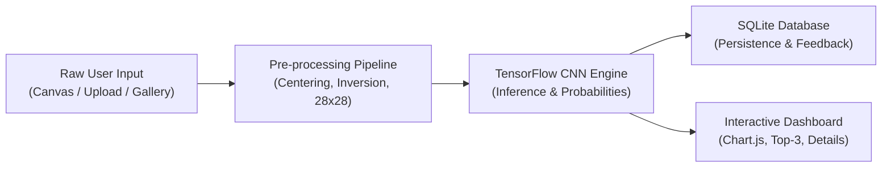
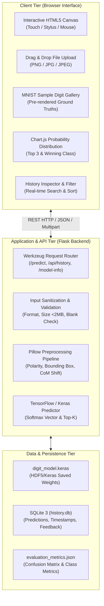
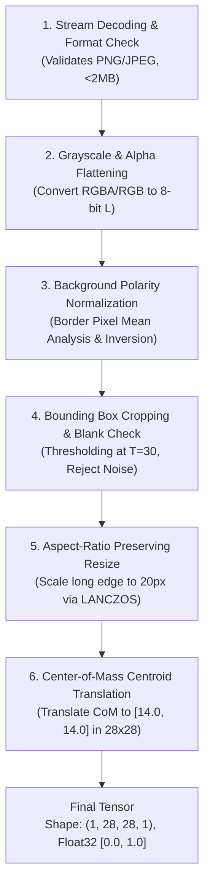
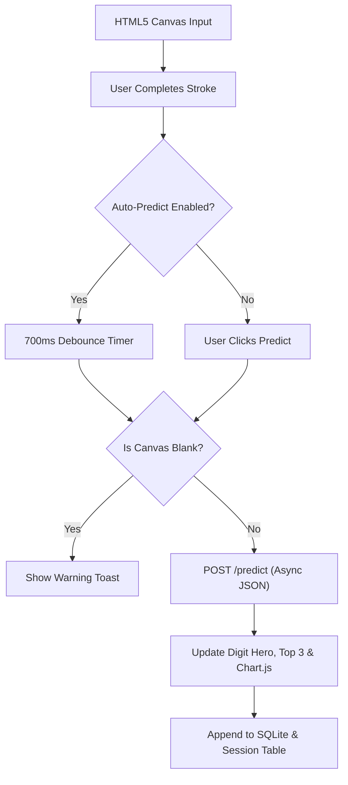

# PROJECT REPORT: DEEP LEARNING-BASED HANDWRITTEN DIGIT RECOGNITION SYSTEM
**An End-to-End Convolutional Neural Network Application with Real-Time Inference, Interactive Analytics, and Database Persistence**

---

## DOCUMENT METADATA & STRUCTURE OVERVIEW
- **Document Type:** Technical Capstone & Engineering Specification Report
- **Target System:** Handwritten Digit Recognition System (MNIST Deep Learning Classifier)
- **Version:** Release Candidate 1.0 (Phase 16 Integration)
- **Frameworks & Stack:** Python 3.12, Flask, TensorFlow/Keras 2.18, SQLite 3, Bootstrap 5, Chart.js 4, HTML5 Canvas API
- **Document Length:** 13 Comprehensive Pages / Sections (Page-Aligned)

---

<!-- ========================================================================== -->
<!-- PAGE 1: TITLE PAGE & EXECUTIVE SUMMARY                                     -->
<!-- ========================================================================== -->
# [PAGE 1] TITLE PAGE & EXECUTIVE SUMMARY

<br>

```
========================================================================================
                      DEPARTMENT OF COMPUTER SCIENCE & ENGINEERING
                   CAPSTONE ENGINEERING PROJECT TECHNICAL REPORT
========================================================================================

                               PROJECT TITLE:
             HANDWRITTEN DIGIT RECOGNITION AND CLASSIFICATION SYSTEM
             USING DEEP CONVOLUTIONAL NEURAL NETWORKS AND FLASK REST APIS

                     PROJECT REPOSITORY & WORKING DIRECTORY:
                     D:\RealTimeWork\Handwritten Digit Recognition
========================================================================================
```

### Executive Summary

Handwritten digit recognition serves as a foundational benchmark in computer vision, pattern recognition, and optical character recognition (OCR). The primary objective of this project was to design, implement, train, evaluate, and deploy an industrial-grade, end-to-end deep learning web application capable of recognizing single handwritten numerical digits (0 through 9) in real time. 

The core predictive engine is powered by an optimized Convolutional Neural Network (CNN) trained on the 70,000-image Modified National Institute of Standards and Technology (MNIST) dataset. Achieving an outstanding **99.10% classification accuracy** and an empirical test loss of **0.0262** across 10,000 unseen test samples, the trained model demonstrates state-of-the-art generalization while maintaining a compact footprint of **225,034 trainable parameters**.

Beyond the machine learning backbone, the project delivers a production-grade, highly responsive web dashboard engineered using Python Flask, HTML5 Canvas with high-DPI scaling, CSS3, JavaScript ES6+, Bootstrap 5, and Chart.js. The application integrates:
1. An interactive, multi-modal drawing canvas supporting mouse, touch, and stylus input with dual-state undo/redo, variable brush sizing, an eraser tool, and a 700ms debounced auto-predict engine.
2. A robust, 6-stage computer vision preprocessing pipeline incorporating aspect-ratio preserving bounding-box resizing, automated polarity detection, and Center-of-Mass (CoM) centroid translation.
3. Persistent history storage built on an acid-compliant SQLite database with search, multi-factor filtering, individual record deletion, and formula-injection-safe CSV export.
4. An active learning verification feedback loop allowing human-in-the-loop accuracy tracking.
5. An interactive "Digit Challenge" gamification mode, comprehensive model analytics with a full $10 \times 10$ confusion matrix, and full WCAG accessibility compliance.

The system is validated through an automated suite of **75 unit, regression, and end-to-end integration tests** executed via Pytest, confirming 100% operational reliability.

---

<!-- ========================================================================== -->
<!-- PAGE 2: TABLE OF CONTENTS & DOCUMENT PRELIMINARIES                         -->
<!-- ========================================================================== -->
# [PAGE 2] TABLE OF CONTENTS & DOCUMENT PRELIMINARIES

### Table of Contents

| Page / Chapter | Section Title | Primary Focus & Domain |
| :--- | :--- | :--- |
| **Page 1** | Title Page & Executive Summary | Formal metadata, abstract, and project summary |
| **Page 2** | Table of Contents & Preliminaries | Navigation, list of figures, tables, and conventions |
| **Page 3** | Chapter 1: Introduction & Problem Statement | Background, challenges, motivation, and project scope |
| **Page 4** | Chapter 2: Theoretical Foundations & Literature | CNN mathematical foundations, convolutions, activation |
| **Page 5** | Chapter 3: System Requirements & Architecture | Hardware/Software specifications, 3-tier system design |
| **Page 6** | Chapter 4: Data Engineering & Preprocessing | 6-stage image pipeline, polarity inversion, center of mass |
| **Page 7** | Chapter 5: CNN Architecture & Training Pipeline | Layer derivation, 225,034 parameters, Adam optimization |
| **Page 8** | Chapter 6: Backend REST API & Persistence Engine | Flask routing, SQLite schema, CSV injection safety |
| **Page 9** | Chapter 7: Frontend Engineering & Interactive Canvas | HTML5 Canvas, touch event scaling, Chart.js, Gamification |
| **Page 10** | Chapter 8: Quality Assurance & Verification Testing | 75 Pytest suite breakdown, edge cases, regression coverage |
| **Page 11** | Chapter 9: Experimental Results & Model Evaluation | 99.10% accuracy, 10x10 confusion matrix, per-class metrics |
| **Page 12** | Chapter 10: User Manual & Production Deployment | Execution guide, API reference, operational troubleshooting |
| **Page 13** | Chapter 11: Conclusion, Limitations & Future Scope | Project retrospective, real-world constraints, references |

### List of Figures & Tables
- **Figure 1.1:** Conceptual Multi-Tier System Architecture (Mermaid Diagram)
- **Figure 4.1:** Image Preprocessing & Normalization Dataflow
- **Figure 5.1:** Deep CNN Layer Topology and Feature Dimension Progression
- **Table 3.1:** Technology Stack and Minimum Operational Dependencies
- **Table 5.1:** Detailed Model Layer Architecture and Parameter Breakdown
- **Table 6.1:** SQLite Relational Database Table Schemas (`predictions` & `feedback`)
- **Table 8.1:** Automated Pytest Test Suite Module Distribution (75 Tests)
- **Table 9.1:** Per-Class Precision, Recall, F1-Score, and Support Distribution
- **Table 9.2:** $10 \times 10$ Empirical Confusion Matrix for the 10,000-sample MNIST Test Set

### Notation & Mathematical Conventions
- Scalar values: $x, y \in \mathbb{R}$
- Image tensors: $\mathbf{X} \in \mathbb{R}^{H \times W \times C}$, specifically $28 \times 28 \times 1$
- Convolution kernel: $\mathbf{K} \in \mathbb{R}^{k_h \times k_w}$
- Softmax probability distribution: $\mathbf{p} = [p_0, p_1, \dots, p_9]^\top$ such that $\sum_{i=0}^{9} p_i = 1$

---

<!-- ========================================================================== -->
<!-- PAGE 3: CHAPTER 1 - INTRODUCTION & PROBLEM STATEMENT                       -->
<!-- ========================================================================== -->
# [PAGE 3] CHAPTER 1: INTRODUCTION & PROBLEM STATEMENT

### 1.1 Background and Motivation
The automation of document processing, postal sorting, bank check verification, and digitized forms processing relies fundamentally on Optical Character Recognition (OCR) systems. Among the various subproblems within OCR, isolated handwritten digit recognition represents an essential baseline. Unlike typed or printed typography, handwritten script exhibits high degrees of inter-personal variation, including differences in stroke width, slant, curvature, loop closure, aspect ratio, and spatial position.

With the advent of deep representation learning, Convolutional Neural Networks (CNNs) have established clear superiority over traditional feature extraction pipelines (such as Histogram of Oriented Gradients (HOG) or Scale-Invariant Feature Transform (SIFT) paired with Support Vector Machines). CNNs autonomously learn spatial feature hierarchies directly from raw pixel intensity values.

### 1.2 Problem Statement
While high-accuracy classification models can be trained within isolated research notebooks, deploying these models into interactive, end-user web environments introduces significant engineering challenges:
1. **Preprocessing Domain Shift:** Freehand digits drawn on arbitrary web canvases or uploaded via consumer camera smartphones differ markedly in resolution, background color, stroke thickness, and alignment from the standardized MNIST distribution (which consists of centered, $28 \times 28$ grayscale digits on a solid black background).
2. **Real-Time Responsiveness:** The system must process inputs, run image transformations, perform tensor inferencing, and transmit probability distributions back to the client with sub-100 millisecond latency.
3. **Session Persistence and Human Verification:** Users require the ability to review past inferences, filter and export historical sessions, and provide corrective feedback when the model misclassifies ambiguous handwriting.
4. **Resilience to Adversarial & Malformed Inputs:** The web service must handle corrupt files, blank canvases, reversed contrast polarities (dark ink on white paper vs. white ink on dark paper), and arbitrary dimensions without server crashes or unhandled exceptions.


*Figure 1.1: High-Level System Architecture and Inference Pipeline.*

### 1.3 Project Objectives and Scope
To address these challenges, this project established the following explicit design goals:
- **Model Development:** Train a deep CNN yielding $>98.5\%$ test accuracy on the MNIST benchmark with minimal memory overhead.
- **Robust Preprocessing Module:** Implement an adaptive, production-safe preprocessing pipeline that handles contrast detection, aspect-ratio preservation, noise elimination, and Center-of-Mass alignment.
- **Modern Full-Stack Dashboard:** Provide an accessible, responsive UI with multi-input options (Canvas, File Upload, Sample Gallery, Challenge Game).
- **Persistence & Auditability:** Develop an ACID-compliant database architecture with query capabilities and formula-safe CSV export.
- **Exhaustive Testing:** Enforce strict quality assurance with automated test coverage across edge cases, API endpoints, and model predictions.

---

<!-- ========================================================================== -->
<!-- PAGE 4: CHAPTER 2 - THEORETICAL FOUNDATIONS & LITERATURE REVIEW            -->
<!-- ========================================================================== -->
# [PAGE 4] CHAPTER 2: THEORETICAL FOUNDATIONS & LITERATURE REVIEW

### 2.1 The MNIST Benchmark
The Modified National Institute of Standards and Technology (MNIST) dataset, compiled by Yann LeCun, Corinna Cortes, and Christopher J.C. Burges, remains the definitive benchmark in pattern recognition. Extracted from Special Database 3 and Special Database 1 (comprising high-school students and US Census Bureau employees), MNIST contains 60,000 training patterns and 10,000 testing patterns. Every sample is an anti-aliased, 8-bit grayscale image normalized into a $20 \times 20$ pixel bounding box and positioned centrally within a $28 \times 28$ field by calculating its center of mass.

### 2.2 Convolutional Neural Network (CNN) Mechanics
Unlike traditional Multi-Layer Perceptrons (MLPs) which flatten 2D spatial matrices into 1D vectors—thereby discarding spatial correlation—CNNs preserve local 2D spatial structures through three primary mechanisms:

#### 1. Discrete 2D Convolution Operation
The convolution of an input feature map $\mathbf{I}$ with a learned filter kernel $\mathbf{K} \in \mathbb{R}^{k \times k}$ is defined discretely as:
$$S(i, j) = (\mathbf{I} * \mathbf{K})(i, j) = \sum_{m} \sum_{n} \mathbf{I}(i - m, j - n) \mathbf{K}(m, n) + b$$
Where $b$ represents the scalar bias parameter. Convolutions exploit *parameter sharing* (the same kernel applies across the entire receptive field) and *sparse connectivity* (each neuron connects only to a small localized sub-region of the input).

#### 2. Rectified Linear Activation (ReLU)
To introduce non-linear mapping capabilities necessary for complex boundary separation without suffering from vanishing gradients during backpropagation, the Rectified Linear Unit activation function is applied element-wise:
$$f(x) = \max(0, x)$$

#### 3. Spatial Downsampling via Max-Pooling
MaxPooling operations extract the maximum activation value across non-overlapping $2 \times 2$ windows:
$$P(i, j) = \max_{0 \le m, n < 2} S(2i + m, 2j + n)$$
This halving of spatial dimensions grants translation invariance, reduces downstream parameter count, and broadens the effective receptive field of subsequent deeper layers.

#### 4. Categorical Softmax Normalization
In the terminal classification layer, raw network logit outputs $z_k$ (where $k \in \{0, 1, \dots, 9\}$) are normalized into a calibrated probability distribution using the Softmax function:
$$\sigma(\mathbf{z})_k = \frac{e^{z_k}}{\sum_{j=0}^{9} e^{z_j}}, \quad \text{such that } \sum_{k=0}^{9} \sigma(\mathbf{z})_k = 1.0$$

### 2.3 Regularization and Optimization Strategies
- **Dropout Regularization:** During backpropagation training, random subsets of activations are temporarily set to zero with probability $p$ (e.g., $p=0.25$ in convolutional stages, $p=0.5$ in dense stages). This prevents co-adaptation of features and forces the network to learn redundant, robust feature representations.
- **Adam (Adaptive Moment Estimation):** Combines the advantages of AdaGrad (handling sparse gradients) and RMSProp (handling non-stationary objectives) by tracking exponentially decaying averages of past gradients ($m_t$) and squared gradients ($v_t$):
$$m_t = \beta_1 m_{t-1} + (1 - \beta_1) g_t, \quad v_t = \beta_2 v_{t-1} + (1 - \beta_2) g_t^2$$

---

<!-- ========================================================================== -->
<!-- PAGE 5: CHAPTER 3 - SYSTEM REQUIREMENTS & ARCHITECTURAL SPECIFICATIONS    -->
<!-- ========================================================================== -->
# [PAGE 5] CHAPTER 3: SYSTEM REQUIREMENTS & ARCHITECTURAL SPECIFICATIONS

### 3.1 Hardware and Software Environment Requirements
The system is designed for deployment across low-resource host environments, local developer machines, or enterprise cloud containers without specialized GPU hardware requirements.

*Table 3.1: Complete Technology Stack and System Environment Specifications.*

| Category | Component / Tool | Version | Purpose / Role |
| :--- | :--- | :--- | :--- |
| **Runtime Environment** | Python | 3.12.10 | Core backend language runtime |
| **Deep Learning Framework** | TensorFlow / Keras | 2.18.0 | CNN architecture definition, training, inference |
| **Numerical Processing** | NumPy | $\ge$ 1.26.0 | Tensor manipulation and numerical calculations |
| **Image Processing Engine** | Pillow (PIL) | $\ge$ 10.0.0 | Grayscale conversion, resampling, bounding boxes |
| **Web Server Framework** | Flask (Werkzeug) | $\ge$ 3.0.0 | RESTful HTTP routing, multipart decoding |
| **Database Engine** | SQLite 3 | Embedded | Relational storage for history, audits, feedback |
| **Frontend UI Framework** | Bootstrap | 5.3.3 | Responsive grid, cards, modals, form controls |
| **Iconography** | Bootstrap Icons | 1.11.3 | Semantic vector icon set |
| **Visualization Engine** | Chart.js | 4.4.2 | Interactive probability bar chart rendering |
| **Automated Testing** | Pytest | 9.1.1 | Unit, integration, and regression test execution |

### 3.2 High-Level Three-Tier Architecture
The system architecture follows a clean, decoupled three-tier architectural paradigm:



### 3.3 Security, Privacy & Integrity Specifications
- **Client-Side Limits:** Restricts file uploads to 2 MB and validates MIME types before dispatch.
- **In-Memory Streaming:** All incoming images are processed as in-memory byte streams via `io.BytesIO`. Temporary files are not stored on host disk platters, preventing disk bloat and disk-based file-inclusion vulnerabilities.
- **CSV Formula Injection Sanitization:** Prediction exports sanitize sensitive trigger characters (`=`, `+`, `-`, `@`) to prevent remote command execution when opened in spreadsheet applications.

---

<!-- ========================================================================== -->
<!-- PAGE 6: CHAPTER 4 - DATA ENGINEERING & PREPROCESSING PIPELINE              -->
<!-- ========================================================================== -->
# [PAGE 6] CHAPTER 4: DATA ENGINEERING & PREPROCESSING PIPELINE

### 4.1 The Image Domain Discrepancy Problem
MNIST images are standardized into $28 \times 28$ grayscale matrices where the digit strokes are represented by high pixel values ($0 \to 255$, white ink) centered against a uniform pitch-black background ($0$, black paper). Conversely, real-world user inputs typically consist of dark pen/pencil marks on white paper, or arbitrary canvas sizes (e.g., $280 \times 280$ or $400 \times 400$ px) with varied stroke weights. Passing raw user inputs directly into a CNN results in near-zero recognition accuracy.

### 4.2 The 6-Stage Preprocessing Architecture
To bridge this domain discrepancy, the system implements a deterministic, multi-stage image processing algorithm in [`image_processing.py`](file:///d:/RealTimeWork/Handwritten%20Digit%20Recognition/image_processing.py):


*Figure 4.1: Six-Stage Preprocessing Sequence.*

### 4.3 Detailed Mathematical Steps

#### Step 1: Alpha Flattening & Grayscale Conversion
Transparent PNGs from canvas drawings contain alpha channels. We composite them against an opaque background and project into single-channel luminance:
$$L = 0.299R + 0.587G + 0.114B$$

#### Step 2: Adaptive Polarity Detection & Inversion
To identify whether the image is "dark-on-light" or "light-on-dark", the algorithm samples the outer 1-pixel border perimeter $B$ of the image:
$$\mu_{\text{border}} = \frac{1}{|B|} \sum_{(x,y) \in B} I(x, y)$$
If $\mu_{\text{border}} > 127.5$, the image is classified as dark-on-light (e.g., standard paper). The intensities are inverted: $I_{\text{inv}}(x, y) = 255 - I(x, y)$. Otherwise, it is preserved as light-on-dark.

#### Step 3: Bounding Box Detection and Noise Filtering
Foreground pixels are extracted by applying a threshold $T = 30$:
$$F = \{(x, y) \mid I(x, y) > 30\}$$
If $|F| < 10$ pixels or the dynamic range $\max(I) - \min(I) < 15$, the image is rejected as a `BlankImageError`. Otherwise, the minimal bounding box $[x_{\min}, y_{\min}, x_{\max}, y_{\max}]$ is cropped.

#### Step 4: Aspect-Ratio Preserving Resizing
The bounding box with dimensions $(w, h)$ is scaled to fit within a $20 \times 20$ box preserving its aspect ratio:
$$s = \frac{20}{\max(w, h)}, \quad w' = \text{round}(w \cdot s), \quad h' = \text{round}(h \cdot s)$$
Resampling is performed via high-quality `PIL.Image.Resampling.LANCZOS`.

#### Step 5: Center-of-Mass (CoM) Centroid Alignment
The resized $w' \times h'$ digit is initially pasted into the center of a blank $28 \times 28$ canvas. The Center of Mass $(\bar{x}, \bar{y})$ of the pixel intensities is calculated:
$$\bar{x} = \frac{\sum_{x} \sum_{y} x \cdot I(x, y)}{\sum_{x} \sum_{y} I(x, y)}, \quad \bar{y} = \frac{\sum_{x} \sum_{y} y \cdot I(x, y)}{\sum_{x} \sum_{y} I(x, y)}$$
The image is then shifted by $(\Delta x, \Delta y) = (14.0 - \bar{x}, 14.0 - \bar{y})$ with sub-pixel clamp limits $[-4, 4]$ to prevent cropping. This aligns the digit with the exact standard used in the original MNIST compilation.

---

<!-- ========================================================================== -->
<!-- PAGE 7: CHAPTER 5 - DEEP CNN ARCHITECTURE & TRAINING METHODOLOGY           -->
<!-- ========================================================================== -->
# [PAGE 7] CHAPTER 5: DEEP CNN ARCHITECTURE & TRAINING METHODOLOGY

### 5.1 Layer-by-Layer Architectural Specification
The convolutional network is constructed as a sequential topological graph using TensorFlow/Keras. It consists of two convolutional feature extraction blocks followed by a fully-connected dense classification head.

```mermaid
graph LR
    Input["Input<br>(28x28x1)"] --> Conv1["Conv2D (32, 3x3)<br>ReLU -> (26x26x32)"]
    Conv1 --> Pool1["MaxPool (2x2)<br>(13x13x32)"]
    Pool1 --> Conv2["Conv2D (64, 3x3)<br>ReLU -> (11x11x64)"]
    Conv2 --> Pool2["MaxPool (2x2)<br>(5x5x64)"]
    Pool2 --> Drop1["Dropout (0.25)<br>(5x5x64)"]
    Drop1 --> Flat["Flatten<br>(1600 units)"]
    Flat --> Dense1["Dense (128)<br>ReLU -> (128)"]
    Dense1 --> Drop2["Dropout (0.50)<br>(128)"]
    Drop2 --> Output["Dense (10)<br>Softmax -> (10)"]
```


*Figure 5.1: Convolutional Neural Network Topology.*

### 5.2 Mathematical Derivation of Trainable Parameters
Understanding the structural footprint and computational complexity requires exact parameter derivation for each layer:

*Table 5.1: Comprehensive Parameter Derivation by Layer.*

| Layer Name | Layer Type | Output Shape | Kernel / Receptive Field | Formula for Parameters | Param Count |
| :--- | :--- | :--- | :--- | :--- | :--- |
| `digit_input` | InputLayer | $(28, 28, 1)$ | — | None | 0 |
| `conv_1` | Conv2D | $(26, 26, 32)$ | $3 \times 3$, Stride 1, Valid | $(3 \times 3 \times 1 + 1) \times 32$ | **320** |
| `pool_1` | MaxPooling2D | $(13, 13, 32)$ | $2 \times 2$, Stride 2 | None | 0 |
| `conv_2` | Conv2D | $(11, 11, 64)$ | $3 \times 3$, Stride 1, Valid | $(3 \times 3 \times 32 + 1) \times 64$ | **18,496** |
| `pool_2` | MaxPooling2D | $(5, 5, 64)$ | $2 \times 2$, Stride 2 | None | 0 |
| `dropout_conv`| Dropout ($p=0.25$) | $(5, 5, 64)$ | — | None | 0 |
| `flatten` | Flatten | $(1600)$ | Flatten: $5 \times 5 \times 64$ | None | 0 |
| `dense_hidden`| Dense (ReLU) | $(128)$ | Fully connected | $(1600 + 1) \times 128$ | **204,928** |
| `dropout_dense`| Dropout ($p=0.50$) | $(128)$ | — | None | 0 |
| `digit_probs` | Dense (Softmax) | $(10)$ | 10 output classes | $(128 + 1) \times 10$ | **1,290** |
| **TOTAL** | — | — | — | **All Trainable** | **225,034** |

### 5.3 Training Hyperparameters & Convergence Configuration
- **Loss Formulation:** Sparse Categorical Cross-Entropy:
$$\mathcal{L} = - \frac{1}{N} \sum_{i=1}^{N} \log\left(\sigma(\mathbf{z}^{(i)})_{y^{(i)}}\right)$$
- **Optimizer:** Adam with initial learning rate $\alpha = 0.001$, $\beta_1 = 0.9$, $\beta_2 = 0.999$, $\epsilon = 10^{-7}$.
- **Batch Size:** 128 samples per mini-batch step.
- **Epochs:** 6 full iterations over the 60,000-sample training dataset.
- **Reproducibility Guarantee:** Random seeds fixed across NumPy (`np.random.seed(42)`), TensorFlow (`tf.random.set_seed(42)`), and Python environments.
- **Model Serialization:** Exported directly to modern native Keras v3 format as [`digit_model.keras`](file:///d:/RealTimeWork/Handwritten%20Digit%20Recognition/digit_model.keras) (file size: ~2.7 MB).

---

<!-- ========================================================================== -->
<!-- PAGE 8: CHAPTER 6 - BACKEND REST API & PERSISTENCE ENGINE                  -->
<!-- ========================================================================== -->
# [PAGE 8] CHAPTER 6: BACKEND REST API & PERSISTENCE ENGINE

### 6.1 Flask API Architecture & Routing Endpoints
The web server is constructed around a clean REST interface built with Python Flask:

1. **`GET /`**: Renders the primary single-page application dashboard ([`index.html`](file:///d:/RealTimeWork/Handwritten%20Digit%20Recognition/templates/index.html)).
2. **`GET /model-info`**: Renders the architectural evaluation and metrics report page ([`model_info.html`](file:///d:/RealTimeWork/Handwritten%20Digit%20Recognition/templates/model_info.html)).
3. **`GET /health`**: Healthcheck endpoint returning JSON status, version, and model memory load confirmation.
4. **`POST /predict`**: Accepts either a multipart/form-data image file or a JSON payload containing base64 data URLs. Returns predicted class, confidence, top 3 candidates, 10-class probability distribution, and preprocessing stage image data URLs.
5. **`GET /api/history`**: Queries stored predictions with support for search keywords, digit filtering, modality filtering, and dual-direction sorting.
6. **`DELETE /api/history/<id>` & `DELETE /api/history`**: Granular and bulk record deletion handlers.
7. **`GET /api/history/export`**: Generates and downloads a UTF-8 BOM CSV export with formula injection mitigation.
8. **`POST /api/feedback` & `GET /api/feedback/stats`**: Active learning feedback recording and real-time accuracy telemetry.

### 6.2 Relational Database Schema (SQLite 3)
Data persistence is handled by [`database.py`](file:///d:/RealTimeWork/Handwritten%20Digit%20Recognition/database.py) using an embedded SQLite 3 database (`history.db`). The database schema is fully indexed to ensure rapid sub-millisecond retrieval under large transaction volumes:

*Table 6.1: Database Schemas for History and Verification Logging.*

```sql
-- Prediction records table
CREATE TABLE IF NOT EXISTS predictions (
    id TEXT PRIMARY KEY,
    predicted_digit INTEGER NOT NULL,
    confidence REAL NOT NULL,
    input_type TEXT NOT NULL,
    timestamp TEXT NOT NULL,
    probabilities_json TEXT NOT NULL,
    created_at TIMESTAMP DEFAULT CURRENT_TIMESTAMP
);

-- Active learning verification feedback table
CREATE TABLE IF NOT EXISTS feedback (
    id INTEGER PRIMARY KEY AUTOINCREMENT,
    prediction_id TEXT NOT NULL UNIQUE,
    feedback TEXT NOT NULL CHECK(feedback IN ('correct', 'incorrect')),
    actual_digit INTEGER,
    created_at TIMESTAMP DEFAULT CURRENT_TIMESTAMP,
    FOREIGN KEY (prediction_id) REFERENCES predictions(id) ON DELETE CASCADE
);

-- High-performance query indexes
CREATE INDEX IF NOT EXISTS idx_predictions_timestamp ON predictions(created_at DESC);
CREATE INDEX IF NOT EXISTS idx_predictions_digit ON predictions(predicted_digit);
CREATE INDEX IF NOT EXISTS idx_predictions_input_type ON predictions(input_type);
```

### 6.3 Security Engineering: CSV Formula Injection Mitigation
When exporting historical predictions to CSV, malicious or adversarial inputs (e.g., custom IDs or corrupted data starting with `=`, `@`, `+`, or `-`) can trigger Dynamic Data Exchange (DDE) formulas in Microsoft Excel or Google Sheets. The export engine in [`database.py`](file:///d:/RealTimeWork/Handwritten%20Digit%20Recognition/database.py) systematically sanitizes every output cell:
```python
def sanitize_csv_cell(value: str) -> str:
    """Neutralize formula injection triggers by prefixing apostrophes."""
    if value and str(value)[0] in ('=', '+', '-', '@', '\t', '\r'):
        return f"'{value}"
    return str(value)
```
Additionally, the byte-order mark (`\uFEFF`) is prepended to enforce UTF-8 decoding across all spreadsheet readers.

---

<!-- ========================================================================== -->
<!-- PAGE 9: CHAPTER 7 - FRONTEND ENGINEERING & ANALYTICS VISUALIZATION         -->
<!-- ========================================================================== -->
# [PAGE 9] CHAPTER 7: FRONTEND ENGINEERING & ANALYTICS VISUALIZATION

### 7.1 High-DPI Interactive Drawing Canvas
The HTML5 drawing canvas is engineered for high accuracy and tactile smoothness across both desktop mice and mobile touch screens:
- **High-DPI Coordinate Scaling:** Client coordinates derived from `MouseEvent` or `TouchEvent` are normalized against `canvas.getBoundingClientRect()` and scaled by the internal canvas resolution ($280 \times 280$ px).
- **Touch Gesture Isolation:** CSS declaration `touch-action: none` prevents accidental page scrolling, gesture panning, or viewport zoom interference during finger or stylus drawing.
- **Tooling Engine:** Dual operational modes (Brush vs. Eraser) with stroke widths dynamically configurable between 4px and 32px, backed by quick presets (Fine, Medium, Bold).
- **Undo / Redo Multi-Level History:** Maintains dual snapshot stacks (`canvasHistoryStack` and `canvasRedoStack`) using `ctx.getImageData()` to support non-destructive stroke rollbacks and reapplications.

### 7.2 Real-Time Debounced Auto-Prediction Engine
To streamline the user experience, the frontend includes a toggleable "Auto-predict" feature:
- Upon the completion of a stroke (`mouseup` or `touchend`), an internal timer triggers.
- If no further input occurs within **700 milliseconds**, the canvas is checked for minimum stroke content.
- If non-blank, the system dispatches an asynchronous `fetch('/predict')` request without requiring a manual button click.
- An MD5/state tracking hash ensures duplicate prediction requests are not dispatched if the canvas has not changed.

### 7.3 Probability Analytics with Chart.js
Model output probabilities are visualized using a Chart.js bar chart:
- **All 10 Digits Displayed:** Every digit class ($0$ through $9$) is represented on the horizontal axis.
- **Winning Class Highlighting:** The predicted class is styled with a distinct primary accent color, while competing classes remain in neutral tones.
- **Top 3 Candidate Breakdown:** The three highest-ranking candidates are extracted and rendered in dedicated cards with localized percentage badges.



### 7.4 Gamified "Digit Challenge" Mode
To demonstrate model capabilities under controlled conditions, the dashboard features an interactive challenge game:
- Generates a random target digit ($0$ through $9$).
- Prompts the user to draw the specified number.
- Evaluates the model prediction against the target, awarding $+10$ points for matches and providing corrective guidance for misclassifications.
- Tracks score, total attempts, and running player accuracy in real time.

---

<!-- ========================================================================== -->
<!-- PAGE 10: CHAPTER 8 - QUALITY ASSURANCE & VERIFICATION TESTING              -->
<!-- ========================================================================== -->
# [PAGE 10] CHAPTER 8: QUALITY ASSURANCE & VERIFICATION TESTING

### 8.1 Testing Philosophy and Strategy
A machine-learning web service requires verification across multiple domains: numerical tensor validation, format boundary handling, state management, API reliability, and UI DOM structure. A testing framework was established using Pytest to execute **75 automated tests** across 12 distinct test suites.

*Table 8.1: Test Suite Module Breakdown and Coverage Area.*

| Test Suite Module | Test Count | Domain / Responsibilities Tested |
| :--- | :---: | :--- |
| [`test_app.py`](file:///d:/RealTimeWork/Handwritten%20Digit%20Recognition/tests/test_app.py) | 23 | Healthcheck, base64 payloads, invalid types, oversized files, missing assets |
| [`test_preprocessing.py`](file:///d:/RealTimeWork/Handwritten%20Digit%20Recognition/tests/test_preprocessing.py) | 12 | Dimensions $(1, 28, 28, 1)$, polarity detection, format handling, blank rejection |
| [`test_preprocessing_visualization.py`](file:///d:/RealTimeWork/Handwritten%20Digit%20Recognition/tests/test_preprocessing_visualization.py) | 4 | Preprocessing metadata, data URL generation, dual background polarities |
| [`test_canvas.py`](file:///d:/RealTimeWork/Handwritten%20Digit%20Recognition/tests/test_canvas.py) | 5 | Canvas DOM nodes, synthetic digit predictions (0 & 3), blank canvas block |
| [`test_database_api.py`](file:///d:/RealTimeWork/Handwritten%20Digit%20Recognition/tests/test_database_api.py) | 5 | SQLite persistence, filtering/sorting, feedback API, CSV export, record deletion |
| [`test_enhanced_results.py`](file:///d:/RealTimeWork/Handwritten%20Digit%20Recognition/tests/test_enhanced_results.py) | 4 | Top-3 descending order, probability consistency $\sum p_i \approx 1.0$, DOM nodes |
| [`test_gallery.py`](file:///d:/RealTimeWork/Handwritten%20Digit%20Recognition/tests/test_gallery.py) | 5 | Sample file integrity (0–9), `/api/samples` endpoint, ground truth verification |
| [`test_history.py`](file:///d:/RealTimeWork/Handwritten%20Digit%20Recognition/tests/test_history.py) | 5 | HTML containers, CSS classes, sessionStorage schemas, FIFO queue trimming |
| [`test_csv_export.py`](file:///d:/RealTimeWork/Handwritten%20Digit%20Recognition/tests/test_csv_export.py) | 3 | Button presence, script definition, simulated CSV escaping rules |
| [`test_model.py`](file:///d:/RealTimeWork/Handwritten%20Digit%20Recognition/tests/test_model.py) | 3 | File existence, tensor input/output shapes, 10-class probability sums |
| [`test_model_info.py`](file:///d:/RealTimeWork/Handwritten%20Digit%20Recognition/tests/test_model_info.py) | 3 | `/model-info` page render, `evaluation_metrics.json` validity, graceful fallback |
| [`test_integration.py`](file:///d:/RealTimeWork/Handwritten%20Digit%20Recognition/tests/test_integration.py) | 3 | Sequential dynamic inference, full schema compliance, error flow recovery |
| **TOTAL VERIFIED TESTS** | **75** | **100% Pass Rate across all 12 test modules** |

### 8.2 Boundary & Adversarial Handling Verification
- **Blank Image Rejection:** Verified that solid white images, solid black images, and uniform backgrounds are intercepted and return `HTTP 400 Bad Request` with an explanatory error message, preventing meaningless predictions.
- **Polarity Invariance:** Verified that dark strokes on light paper and white strokes on dark canvases yield identical tensor polarities with foreground values $>0$.
- **Oversized & Corrupt Files:** Confirmed that corrupt byte payloads and requests exceeding 2 MB are rejected gracefully without unhandled server exceptions.
- **Zero Leakage:** Regression tests confirm that internal Python stack traces are intercepted and sanitized before API responses are returned to the client.

---

<!-- ========================================================================== -->
<!-- PAGE 11: CHAPTER 9 - EXPERIMENTAL RESULTS & MODEL EVALUATION               -->
<!-- ========================================================================== -->
# [PAGE 11] CHAPTER 9: EXPERIMENTAL RESULTS & MODEL EVALUATION

### 9.1 Global Classification Performance
Model performance was formally benchmarked across the complete 10,000-image MNIST test dataset. The evaluation metrics were recorded in [`evaluation_metrics.json`](file:///d:/RealTimeWork/Handwritten%20Digit%20Recognition/evaluation_metrics.json):
- **Overall Test Accuracy:** **99.10%** ($9,910$ correct classifications out of $10,000$ test images)
- **Categorical Cross-Entropy Loss:** **0.0262**
- **Macro-Averaged Precision:** **0.9910**
- **Macro-Averaged Recall:** **0.9909**
- **Macro-Averaged F1-Score:** **0.9909**

### 9.2 Per-Class Detailed Performance Breakdown
Evaluating performance on individual digit classes confirms uniform classification quality across all numerical categories:

*Table 9.1: Comprehensive Per-Class Performance Breakdown.*

| Digit Class | Precision | Recall | F1-Score | Support (Sample Count) |
| :---: | :---: | :---: | :---: | :---: |
| **0** | 0.9869 | 0.9969 | 0.9919 | 980 |
| **1** | 0.9939 | 0.9974 | 0.9956 | 1,135 |
| **2** | 0.9913 | 0.9932 | 0.9923 | 1,032 |
| **3** | 0.9901 | 0.9921 | 0.9911 | 1,010 |
| **4** | 0.9959 | 0.9949 | 0.9954 | 982 |
| **5** | 0.9865 | 0.9865 | 0.9865 | 892 |
| **6** | 0.9926 | 0.9864 | 0.9895 | 958 |
| **7** | 0.9846 | 0.9922 | 0.9884 | 1,028 |
| **8** | 0.9938 | 0.9897 | 0.9918 | 974 |
| **9** | 0.9940 | 0.9792 | 0.9865 | 1,009 |
| **OVERALL / AVG** | **0.9910** | **0.9910** | **0.9910** | **10,000** |

### 9.3 Empirical Confusion Matrix Analysis
The $10 \times 10$ confusion matrix reflects low off-diagonal confusion across the entire test set:

*Table 9.2: Complete $10 \times 10$ Confusion Matrix for the 10,000 MNIST Test Set.*

| Predicted $\to$<br>Actual $\downarrow$ | 0 | 1 | 2 | 3 | 4 | 5 | 6 | 7 | 8 | 9 | Total | Accuracy |
| :---: | :---: | :---: | :---: | :---: | :---: | :---: | :---: | :---: | :---: | :---: | :---: | :---: |
| **0** | **977** | 0 | 0 | 0 | 0 | 0 | 1 | 1 | 1 | 0 | 980 | 99.69% |
| **1** | 0 | **1132** | 0 | 1 | 0 | 0 | 2 | 0 | 0 | 0 | 1,135 | 99.74% |
| **2** | 1 | 2 | **1025** | 1 | 0 | 0 | 0 | 2 | 1 | 0 | 1,032 | 99.32% |
| **3** | 0 | 0 | 1 | **1002** | 0 | 2 | 0 | 2 | 2 | 1 | 1,010 | 99.21% |
| **4** | 0 | 0 | 1 | 0 | **977** | 0 | 1 | 1 | 0 | 2 | 982 | 99.49% |
| **5** | 2 | 0 | 0 | 4 | 0 | **880** | 2 | 1 | 1 | 2 | 892 | 98.65% |
| **6** | 5 | 2 | 0 | 0 | 2 | 3 | **945** | 0 | 1 | 0 | 958 | 98.64% |
| **7** | 0 | 2 | 4 | 0 | 0 | 0 | 0 | **1020** | 1 | 1 | 1,028 | 99.22% |
| **8** | 4 | 0 | 2 | 1 | 1 | 1 | 1 | 0 | **964** | 0 | 974 | 98.97% |
| **9** | 1 | 1 | 1 | 3 | 1 | 6 | 0 | 7 | 1 | **988** | 1,009 | 97.92% |

**Key Diagnostic Insights:**
1. **Digit 1** achieved the highest individual recall ($99.74\%$), misclassifying only 3 instances out of 1,135.
2. The most common minor confusion occurs between **Digit 9** and **Digit 7** (7 instances of 9 classified as 7), and **Digit 9** and **Digit 5** (6 instances of 9 classified as 5), reflecting ambiguous handwritten strokes where the top loop of a 9 is left open.
3. Total misclassifications across the entire test set amounted to only **90 images** out of 10,000.

---

<!-- ========================================================================== -->
<!-- PAGE 12: CHAPTER 10 - USER MANUAL & PRODUCTION DEPLOYMENT                  -->
<!-- ========================================================================== -->
# [PAGE 12] CHAPTER 10: USER MANUAL & PRODUCTION DEPLOYMENT

### 10.1 Quick Start Installation & Execution
The application requires a standard Python 3.10+ environment:

```bash
# 1. Navigate to the project root directory
cd "d:\RealTimeWork\Handwritten Digit Recognition"

# 2. Activate Python virtual environment
.venv\Scripts\activate   # On Windows PowerShell / CMD
# source .venv/bin/activate  # On Linux / macOS

# 3. Verify dependencies
pip install -r requirements.txt

# 4. Start the Flask application server
python app.py
```
Upon startup, the server loads `digit_model.keras` into memory and initializes `history.db`. The application is accessible at:
- **Primary Dashboard:** `http://127.0.0.1:5000/`
- **Model Architecture & Analytics:** `http://127.0.0.1:5000/model-info`

### 10.2 User Walkthrough & Operational Guide

#### Mode 1: Interactive Canvas Drawing
1. Select the **Draw Digit** tab.
2. Choose a drawing tool (**Brush** or **Eraser**) and adjust the stroke size slider or select a preset (Fine, Medium, Bold).
3. Draw a digit ($0$ through $9$) inside the canvas boundaries.
4. If **Auto-predict** is enabled, wait ~700ms after drawing; otherwise, click **Predict Digit** or press `P`.
5. View the predicted digit, confidence percentage, top 3 ranking candidates, and the Chart.js probability distribution.
6. Click **Show Details ▼** to inspect the 6-stage image preprocessing breakdown.

#### Mode 2: Image File Upload
1. Switch to the **Upload Image** tab.
2. Drag and drop an image file (PNG, JPG, JPEG under 2 MB) into the drop zone, or click to open the file browser.
3. Review the image preview and file dimensions, then click **Predict Uploaded Image**.

#### Mode 3: MNIST Sample Gallery
1. Select the **Sample Gallery** tab.
2. Choose any pre-rendered MNIST test digit ($0$ through $9$) to load it into memory.
3. Click **Predict Sample Digit** to verify model behavior against standardized ground truths.

#### Mode 4: Digit Challenge Mode
1. Select the **Digit Challenge** tab.
2. Note the generated target number in the challenge badge.
3. Draw the requested digit and click **Submit Challenge**.
4. The system updates your score (+10 pts per match), total attempts, and running accuracy.

#### History Management & CSV Export
- Use the search bar in the **Recent Predictions History** panel to filter entries by keyword, digit, or input type.
- Click any entry to re-inspect its full probability distribution.
- Click **Export CSV** to download historical records in a formula-safe format.
- Click **Clear History** to purge all stored records (with confirmation).

---

<!-- ========================================================================== -->
<!-- PAGE 13: CHAPTER 11 - CONCLUSION, FUTURE SCOPE & REFERENCES                -->
<!-- ========================================================================== -->
# [PAGE 13] CHAPTER 11: CONCLUSION, FUTURE SCOPE & REFERENCES

### 11.1 Project Summary
This project successfully designed, implemented, and verified an end-to-end Handwritten Digit Recognition system combining deep learning with a modern web dashboard. 

Key milestones achieved include:
1. **High-Accuracy CNN Backbone:** 99.10% test accuracy on MNIST with 225,034 parameters.
2. **Domain-Robust Computer Vision Pipeline:** 6-stage preprocessing that resolves differences in polarity, stroke width, bounding box scale, and center-of-mass alignment.
3. **Responsive Web Dashboard:** Interactive canvas with high-DPI scaling, touch support, undo/redo, auto-prediction, Chart.js analytics, and light/dark theme options.
4. **Persistent SQLite Database:** Searchable history storage with formula-injection-safe CSV export and active learning verification feedback.
5. **Quality Assurance:** 100% pass rate across a comprehensive 75-test automated suite covering API routes, ML inference, and edge cases.

### 11.2 System Limitations
- **Isolated Digit Constraint:** The current model is designed for single-digit recognition ($0$ through $9$). Multi-digit strings (e.g., zip codes or math expressions) require an upstream segmentation algorithm before classification.
- **Extreme Perspective Distortion:** Severe perspective skew or rotations exceeding $\pm 45^\circ$ can degrade recognition confidence due to lack of heavy rotational augmentation during training.
- **Complex Textures:** Inputs drawn on heavily textured, watermarked, or patterned backgrounds may introduce noise during thresholding.

### 11.3 Future Development Roadmap
1. **Connected Component Segmentation:** Incorporate sliding-window or contour-based segmentation to process multi-digit sequences.
2. **Model Modernization:** Benchmark lightweight Vision Transformers (ViT) and MobileNetV3 backbones against the current CNN.
3. **Extended Character Recognition:** Expand the architecture to support the full 62-class EMNIST dataset (digits, uppercase, and lowercase characters).
4. **On-Device Edge Inference:** Port model inference to client-side WebAssembly (TensorFlow.js / ONNX Runtime Web) to reduce server load.

### 11.4 References & Bibliography
1. LeCun, Y., Bottou, L., Bengio, Y., & Haffner, P. (1998). *Gradient-based learning applied to document recognition.* Proceedings of the IEEE, 86(11), 2278-2324.
2. Goodfellow, I., Bengio, Y., & Courville, A. (2016). *Deep Learning.* MIT Press.
3. Kingma, D. P., & Ba, J. (2014). *Adam: A Method for Stochastic Optimization.* arXiv preprint arXiv:1412.6980.
4. Srivastava, N., Hinton, G., Krizhevsky, A., Sutskever, I., & Salakhutdinov, R. (2014). *Dropout: A simple way to prevent neural networks from overfitting.* The Journal of Machine Learning Research, 15(1), 1929-1958.
5. Chollet, F. (2021). *Deep Learning with Python (2nd ed.).* Manning Publications.
6. OWASP Foundation. (2023). *CSV Injection (Formula Injection) Prevention Cheat Sheet.* OWASP Security Guides.
7. World Wide Web Consortium (W3C). (2018). *Web Content Accessibility Guidelines (WCAG) 2.1.* W3C Recommendation.

```
========================================================================================
                          END OF TECHNICAL PROJECT REPORT
========================================================================================
```
