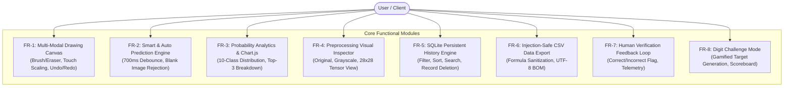

# SOFTWARE REQUIREMENTS SPECIFICATION (SRS)
## HANDWRITTEN DIGIT RECOGNITION AND DEEP LEARNING CLASSIFICATION SYSTEM
**Standard: IEEE Std 830-1998 / ISO/IEC/IEEE 29148:2018 Compliant Specification**  
**Document Release:** Version 1.0.0 (Phase 16 Production Baseline) | **Working Directory:** `D:\RealTimeWork\Handwritten Digit Recognition`

---

<!-- ========================================================================== -->
<!-- SRS PAGE 1: PROJECT OVERVIEW & MACHINE LEARNING MODEL SPECIFICATIONS       -->
<!-- ========================================================================== -->
# [PAGE 1] PRODUCT OVERVIEW & MACHINE LEARNING MODEL SPECIFICATIONS

### 1. Introduction, Purpose and Scope
This Software Requirements Specification (SRS) details the operational, functional, architectural, and mathematical requirements for the **Handwritten Digit Recognition System**. The application delivers real-time inference of isolated handwritten numerical digits ($0$ through $9$) using a Convolutional Neural Network (CNN) integrated into a Python Flask web service with client-side canvas interactions, persistent SQLite storage, and analytics visualization.

### 2. Overall System Description & Operational Context
The system operates as a self-contained, three-tier web application:
- **Client Tier:** HTML5 Canvas (high-DPI, touch/stylus/mouse enabled), Bootstrap 5, Chart.js 4.
- **Application Tier:** Python 3.12 Flask REST server executing image transformation, preprocessing, and TensorFlow/Keras inference.
- **Data Tier:** Embedded SQLite 3 (`history.db`) for transaction logging and `digit_model.keras` for model weights.

---

### 3. Machine Learning & Deep Learning Model Specifications

```mermaid
flowchart LR
    Input["Input Tensor<br>(28, 28, 1)"] --> Conv1["Conv2D (32, 3x3)<br>ReLU | 320 params"]
    Conv1 --> Pool1["MaxPool (2x2)<br>(13, 13, 32)"]
    Pool1 --> Conv2["Conv2D (64, 3x3)<br>ReLU | 18,496 params"]
    Conv2 --> Pool2["MaxPool (2x2)<br>(5, 5, 64)"]
    Pool2 --> Drop1["Dropout (p=0.25)<br>Regularization"]
    Drop1 --> Flat["Flatten<br>(1,600 units)"]
    Flat --> Dense1["Dense (128)<br>ReLU | 204,928 params"]
    Dense1 --> Drop2["Dropout (p=0.50)<br>Regularization"]
    Drop2 --> Dense2["Dense (10)<br>Softmax | 1,290 params"]
    Dense2 --> Output["Class Vector p<br>sum(p_i) = 1.0"]
```



#### 3.1 Model Topology & Parameter Derivation
The classification engine employs a sequential Convolutional Neural Network containing **225,034 total trainable parameters** (zero non-trainable parameters) across the following topological layers:

| Layer Identifier | Layer Type | Output Shape | Kernel / Receptive Field | Activation | Parameter Calculation | Trainable Params |
| :--- | :--- | :--- | :--- | :--- | :--- | :---: |
| `digit_input` | InputLayer | $(28, 28, 1)$ | — | — | $0$ | $0$ |
| `conv_1` | Conv2D | $(26, 26, 32)$ | $3 \times 3$, Stride 1, Valid | ReLU | $(3 \times 3 \times 1 + 1) \times 32$ | **320** |
| `pool_1` | MaxPooling2D | $(13, 13, 32)$ | $2 \times 2$, Stride 2 | — | None | $0$ |
| `conv_2` | Conv2D | $(11, 11, 64)$ | $3 \times 3$, Stride 1, Valid | ReLU | $(3 \times 3 \times 32 + 1) \times 64$ | **18,496** |
| `pool_2` | MaxPooling2D | $(5, 5, 64)$ | $2 \times 2$, Stride 2 | — | None | $0$ |
| `dropout_conv` | Dropout | $(5, 5, 64)$ | Rate = $0.25$ | — | None | $0$ |
| `flatten` | Flatten | $(1600)$ | $5 \times 5 \times 64$ units | — | None | $0$ |
| `dense_hidden` | Dense | $(128)$ | Fully connected | ReLU | $(1600 + 1) \times 128$ | **204,928** |
| `dropout_dense`| Dropout | $(128)$ | Rate = $0.50$ | — | None | $0$ |
| `digit_probs` | Dense | $(10)$ | 10 output classes | Softmax | $(128 + 1) \times 10$ | **1,290** |
| **TOTAL** | — | — | — | — | **All Trainable** | **225,034** |

#### 3.2 Mathematical Formulation of Output Probabilities
Logits $z_k$ produced by `digit_probs` are normalized via the categorical Softmax activation function:
$$p_k = \sigma(\mathbf{z})_k = \frac{e^{z_k}}{\sum_{j=0}^{9} e^{z_j}}, \quad \forall k \in \{0, 1, \dots, 9\}, \quad \text{such that} \quad \sum_{k=0}^{9} p_k = 1.0$$
The predicted digit is determined by the maximum likelihood class: $\hat{y} = \arg\max_{k \in \{0, \dots, 9\}} p_k$, with confidence $c = \max_k p_k$.

#### 3.3 Training Strategy & Optimization Configuration
- **Dataset:** Modified NIST (MNIST) consisting of $60,000$ training images and $10,000$ test images.
- **Loss Function:** Sparse Categorical Cross-Entropy: $\mathcal{L} = -\frac{1}{N}\sum_{i=1}^N \log(\sigma(\mathbf{z}^{(i)})_{y^{(i)}})$.
- **Optimizer:** Adam ($\alpha = 0.001$, $\beta_1 = 0.9$, $\beta_2 = 0.999$, $\epsilon = 10^{-7}$).
- **Batch Size & Epochs:** Mini-batch size of $128$ over $6$ full training epochs.
- **Reproducibility:** Seed fixed across environments (`seed=42`).

#### 3.4 Verified Evaluation Performance Metrics
Evaluated on the $10,000$-sample MNIST test dataset (from `evaluation_metrics.json`):
- **Test Classification Accuracy:** **99.10%** ($9,910 / 10,000$ correct classifications)
- **Categorical Cross-Entropy Test Loss:** **0.0262**
- **Macro-Averaged Precision / Recall / F1-Score:** **0.9910 / 0.9909 / 0.9909**
- **Per-Class F1-Scores:** `0`: 0.9919 | `1`: 0.9956 | `2`: 0.9923 | `3`: 0.9911 | `4`: 0.9954 | `5`: 0.9865 | `6`: 0.9895 | `7`: 0.9884 | `8`: 0.9918 | `9`: 0.9865

#### 3.5 6-Stage Computer Vision Preprocessing Pipeline
Input images pass through a standardized transformation sequence in `image_processing.py`:
1. **Decode & Format Check:** Enforces PNG/JPEG/JPG formats and $\le 2\text{MB}$ payload size.
2. **Grayscale & Alpha Compositing:** Projects RGBA/RGB to single-channel 8-bit luminance ($L = 0.299R + 0.587G + 0.114B$).
3. **Adaptive Polarity Inversion:** Computes border perimeter intensity mean $\mu_{\text{border}}$. If $\mu_{\text{border}} > 127.5$ (dark-on-light), pixels invert ($I' = 255 - I$).
4. **Bounding Box Cropping & Blank Guard:** Masks pixels with threshold $T=30$. If foreground $< 10$ pixels or dynamic range $< 15$, raises `BlankImageError`.
5. **Aspect-Ratio Preserving Resize:** Scales largest bounding box dimension to $20\text{px}$ using Lanczos resampling.
6. **Center of Mass (CoM) Centroid Shift:** Centers digit in $28 \times 28$ matrix and shifts by $(\Delta x, \Delta y) = (14.0 - \bar{x}, 14.0 - \bar{y})$ clamped to $[-4, 4]$ pixels. Normalizes float32 intensities to $[0.0, 1.0]$.

---

<!-- ========================================================================== -->
<!-- SRS PAGE 2: FUNCTIONAL, INTERFACE, AND NON-FUNCTIONAL REQUIREMENTS         -->
<!-- ========================================================================== -->
# [PAGE 2] FUNCTIONAL, INTERFACE, AND NON-FUNCTIONAL REQUIREMENTS

### 4. Functional Requirements Specifications



- **FR-1: Multi-Modal Canvas:** The system shall support mouse, touch, and stylus input on a $280 \times 280\text{px}$ canvas, scaling client coordinates accurately while applying `touch-action: none` to block scrolling. It shall support Brush and Eraser tools (4px–32px), multi-step Undo/Redo, and keyboard shortcuts (`Ctrl+Z`, `Ctrl+Y`, `C`, `P`, `B`, `E`).
- **FR-2: Smart & Auto Prediction:** The system shall support on-demand inference and an optional ~700ms debounced auto-predict mode triggered after stroke completion. Repeated blank submissions shall be rejected with `HTTP 400`.
- **FR-3: Probability Visualization:** The system shall display the predicted digit, confidence percentage, top 3 candidates, and a full 10-class horizontal bar chart rendered via Chart.js highlighting the winning digit.
- **FR-4: Preprocessing Inspector:** The system shall provide an expandable inspection card illustrating original input, polarity-corrected grayscale, and final $28 \times 28$ centered tensor image.
- **FR-5: History Persistence (SQLite):** All predictions shall persist across page reloads and server restarts in SQLite (`history.db`). The UI shall provide real-time search, filtering by digit ($0$–$9$) and modality (*Canvas*, *Upload*, *Sample*), sorting by date and confidence, and single/bulk deletion.
- **FR-6: Safe CSV Export:** The system shall export historical records via `GET /api/history/export` with UTF-8 BOM encoding and prefix sanitization (`'`) for cells starting with `=`, `+`, `-`, `@`, `\t`, or `\r`.
- **FR-7: Verification Feedback Loop:** Users shall be able to mark predictions as "Correct" or "Incorrect" (with ground-truth actual digit selection), recorded in SQLite to track observed accuracy via `GET /api/feedback/stats`.
- **FR-8: Digit Challenge Mode:** The system shall generate a random target digit ($0$–$9$) and update a persistent player scoreboard (+10 pts per match, total attempts, running accuracy).

---

### 5. External Interface & REST API Specifications

| Method | Endpoint | Input Payload / Parameters | Success Output (JSON / Media) |
| :--- | :--- | :--- | :--- |
| `GET` | `/` | None | `200 OK` (Renders `index.html` single-page application) |
| `GET` | `/model-info` | None | `200 OK` (Renders `model_info.html` architectural report) |
| `GET` | `/health` | None | `{"status": "ok", "model_loaded": true, "version": "1.0.0"}` |
| `POST` | `/predict` | Multipart file (`file`) OR JSON `{"image": "data:image/png;base64,..."}` | `{"success": true, "predicted_digit": int, "confidence": float, "probabilities": dict, "top_three": list, "preprocessing": dict, "prediction_id": str}` |
| `GET` | `/api/history` | Query params: `search`, `digit`, `input_type`, `sort_by`, `sort_order` | `{"success": true, "history": list, "total": int}` |
| `DELETE`| `/api/history/<id>`| Record ID in URL | `{"success": true, "message": "Record deleted"}` |
| `DELETE`| `/api/history` | None | `{"success": true, "message": "All history cleared"}` |
| `GET` | `/api/history/export`| None | `200 OK` (`Content-Type: text/csv; charset=utf-8`, attachment) |
| `POST` | `/api/feedback` | `{"prediction_id": str, "feedback": "correct"|"incorrect", "actual_digit": int}` | `{"success": true, "message": "Feedback recorded", "stats": dict}` |
| `GET` | `/api/feedback/stats`| None | `{"success": true, "stats": {"total_predictions": int, "total_feedback": int, "observed_accuracy": float}}` |

---

### 6. Non-Functional & Operational Requirements (NFR)
- **NFR-1: Latency & Performance:** Model inference execution shall complete within $\le 30\text{ms}$ on standard CPU hardware. Total end-to-end HTTP request-response round-trip shall remain under $100\text{ms}$.
- **NFR-2: Security & Integrity:** Incoming file uploads are capped at $2\text{MB}$. File processing executes entirely in memory (`io.BytesIO`) without temporary disk artifact creation. CSV export enforces formula-injection neutralization.
- **NFR-3: Quality Assurance & Automated Testing:** The system shall maintain **100% pass rate across 75 automated Pytest tests** covering API routes, edge-case rejection, image preprocessing, and SQLite persistence.
- **NFR-4: Accessibility & Cross-Device Usability:** Compliant with WCAG 2.1 Level AA standards. All interactive canvas, buttons, and gallery cards feature explicit `:focus-visible` outlines, ARIA roles, and keyboard navigation. Includes persistent Light/Dark themes.

---

### 7. Verification Traceability Matrix & Sign-Off

| Requirement ID | Verification Method | Associated Automated Test Suite | Status |
| :---: | :---: | :---: | :---: |
| **FR-1** (Canvas) | End-to-End & DOM Inspection | `tests/test_canvas.py` (5 tests) | **VERIFIED** |
| **FR-2** (Prediction) | Unit & Boundary Testing | `tests/test_app.py`, `tests/test_preprocessing.py` (35 tests) | **VERIFIED** |
| **FR-3** (Probabilities)| Integration Testing | `tests/test_enhanced_results.py` (4 tests) | **VERIFIED** |
| **FR-4** (Preprocessing)| Preprocessing Transformation | `tests/test_preprocessing_visualization.py` (4 tests) | **VERIFIED** |
| **FR-5** (SQLite History)| DB Transaction Tests | `tests/test_database_api.py`, `tests/test_history.py` (10 tests) | **VERIFIED** |
| **FR-6** (CSV Export) | CSV Escaping & Injection Simulation | `tests/test_csv_export.py` (3 tests) | **VERIFIED** |
| **FR-7** (Feedback API)| API Integration Tests | `tests/test_database_api.py` (Feedback test) | **VERIFIED** |
| **FR-8** (Challenge) | DOM & UI Verification | `tests/test_app.py` (DOM tests) | **VERIFIED** |
| **ML-1** (CNN Model) | Tensor Shape & Weight Inspection | `tests/test_model.py`, `tests/test_model_info.py` (6 tests) | **VERIFIED** |

```
========================================================================================
                          END OF SOFTWARE REQUIREMENTS SPECIFICATION
========================================================================================
```
